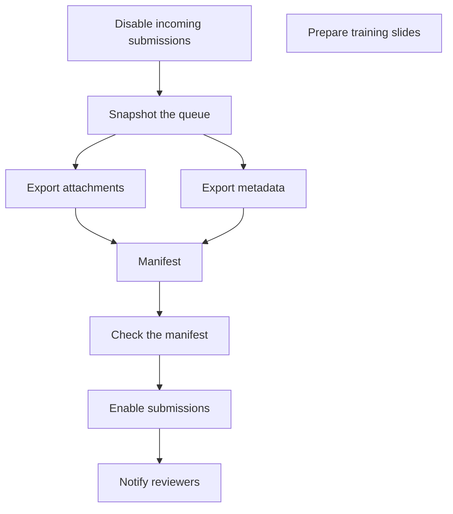

# Consumer B evidence

- Agent: /root/review005_consumer_b
- Date: 2026-11-04
- Exposed model identifier: not exposed
- Provided baseline: 0ef087801f826d749c791f4116012930dcddfce7
- Context: one fresh consumer context containing five requests, processed sequentially.
- Working directory: /workspace/scratch/843c75a4f4c3
- Skill path: /workspace/scratch/843c75a4f4c3/Technical-Writing-Assistant/technical-writing-assistant/SKILL.md
- Evidence path: /workspace/scratch/843c75a4f4c3/Technical-Writing-Assistant/docs/dev/reviews/005_0ef0878-comprehensive-skill-review/evidence/consumer-b.md
- Actions: read the entry and the eight references listed in the response, confirmed cwd, and wrote only this evidence file after completing the response. No repository docs, campaigns, tests, history, external sources, implementation, or signature were inspected. No source edits, send/publish actions, or commit.
- Source-identity limits: the baseline is supplied metadata only. No Git state, revision identity, hashes, or correspondence between the working-tree skill files and the baseline was verified. Behavior and factual notes were treated as supplied inputs, not independently corroborated facts.
- Evidence write is separate from the five task responses and does not alter them.
- Post-write checks read only this evidence file. An initial closing-newline assertion failed because the record has an extra trailing blank line; the subsequent exact comparison confirmed that the preserved response matches the completed response byte for byte as text. These checks did not modify the verbatim prompt or response.

## Verbatim initial task message

````text
Use the repository skill /workspace/scratch/843c75a4f4c3/Technical-Writing-Assistant/technical-writing-assistant/SKILL.md, reading entry first and choosing references as needed. Process the five ordinary requests below sequentially as separate numbered deliverables. Do not inspect repository docs, campaigns, tests, history or external sources, change source files, or send/publish anything. Return full actual responses, then factual trace of references loaded per request/actions/limits. Do not critique the skill or state expected answers. After completion, preserve exact initial message and exact unedited response in ONLY docs/dev/reviews/005_0ef0878-comprehensive-skill-review/evidence/consumer-b.md; this separate evidence write must not change the task responses. Include agent name/date, exposed model identifier or 'not exposed', provided baseline 0ef087801f826d749c791f4116012930dcddfce7, one fresh context/five requests, paths/actions/source-identity limits. Four-backtick text fences around verbatim prompt/output. No commit.

1. Findings-only assessment of size and explanatory detail for novice volunteers. Full procedure: 'Before opening the archive box, copy its identifier into the intake form. Photograph the sealed box. Open it on a clean table. Count the folders without rearranging them. Copy the box identifier onto the temporary tray label before moving any folder to that tray. Keep the original folder order. If loose items have no clear place, stop and ask the archivist.' Do not automatically shorten it.

2. Generate a dependency map from these supplied relationships, with no invented owners or dates: 'Disable incoming submissions before snapshotting the queue. Export attachments and export metadata can run in parallel after the snapshot. The manifest requires both exports. Check the manifest before enabling submissions. Notify reviewers after enabling submissions. Separately, prepare the training slides; no dependency on queue work is specified.'

3. Validate and review this outline against its brief, findings only. Brief: a six-minute explanation to new staff, covering Purpose, Setup, Failure recovery; use only the supplied system notes. Outline: Purpose; Setup; Guaranteed recovery. Notes: setup requires an access token; access-token acquisition is undocumented; failure-recovery behavior is not implemented. The outline says 'Guaranteed recovery: all failures recover automatically'.

4. Revise these two passages using only their supplied notes, flag substantive changes afterward. Scientific passage: 'Our intervention causes faster recovery in every patient.' Notes: nonrandomized pilot, 16 adults, observed shorter recovery, no control group, no external replication. Client passage: 'We guarantee shipment this Friday.' Notes: Friday is a provisional target; supplier confirmation pending; no shipping commitment approved. Do not send a message.

5. Review this Python docstring for consistency with supplied behavior and project convention, findings only. Project uses reStructuredText field lists. Behavior: optional `limit`, None means all available records; negative limits raise ValueError; function returns a list and does not change stored records. Docstring: 'Fetch records.\n\n:param limit: Number to remove.\n:returns: None\n:raises TimeoutError: If records are missing.' No implementation is available.
````

## Verbatim unedited response

````text
1. **Procedure: size and explanatory detail**

The procedure is appropriately brief for a bounded intake task. Its seven short sentences each contribute an action, a timing condition, or a safeguard. There is no clear excess that warrants shortening.

- **Retain both identifier instructions.** Recording the identifier in the intake form and putting it on the temporary tray serve different destinations and moments. Removing the second instruction would lose the explicit requirement to label the tray before transferring folders.
- **Retain the order safeguards.** “Without rearranging them” applies during counting; “Keep the original folder order” reinforces the constraint during subsequent handling. This repetition supports novices at different steps.
- **The operational sequence is sufficiently explicit.** Photographing the box while sealed and labeling the tray before moving folders make important timing visible. The final stop-and-ask instruction gives volunteers a clear response to uncertain loose items.
- **Conditional novice-support gap:** the passage does not explain where to find the box identifier, which intake form or tray label to use, or how to contact the archivist. If these have not been covered in orientation or accompanying materials, volunteers could stall or choose inconsistently. Provide those concrete references at the point of use; the supplied text does not establish what they should be.

Assessment is limited to this complete procedure and the stated novice audience. No rewrite or shortening is proposed.

2. **Dependency map**

Arrows mean “must precede.”



The two exports can run in parallel after the snapshot; both are prerequisites for the manifest. Training-slide preparation has no specified dependency on the queue work. No owners or dates were supplied or added.

3. **Outline: validation and review findings**

Checked against the supplied brief and system notes only.

| Criterion and location | Outcome | Finding and remedy |
|---|---|---|
| Source fidelity: “Guaranteed recovery: all failures recover automatically” | Failed | The notes say failure-recovery behavior is not implemented. The heading and claim would give new staff an unsupported operational guarantee. Remove the guarantee and make the implementation limit explicit in the required failure-recovery section. This changes the substantive claim. |
| Required Purpose coverage: “Purpose” | Partly satisfied | A heading exists, but no purpose explanation is supplied. Its adequacy cannot be judged from the heading, and the notes provide no purpose content to develop. Retain the topic and flag the missing source material rather than inventing it. |
| Required Setup coverage: “Setup” | Partly satisfied | The heading exists, but the outline does not identify the required access token. Include that prerequisite. Token acquisition is undocumented in the notes, so the acquisition steps remain a source gap; do not fabricate them. This gap limits the outline’s usefulness to new staff. |
| Required Failure recovery coverage: “Guaranteed recovery” | Failed | The topic is represented by a contradictory promise rather than an accurate explanation of the supplied implementation status. Cover the stated lack of implemented recovery; the supplied notes do not authorize an alternative recovery procedure. |
| Sequence: Purpose → Setup → recovery | Satisfied | The order offers a coherent progression from why the system is used to preparation and failure-related limitations. No reordering is necessary on the supplied evidence. |
| Six-minute duration | Not assessable | Headings and one content statement do not establish speaking time or the amount of explanation. Check timing after accurate content is available; do not infer a duration from the number of headings. |

The contradictory recovery promise is the highest-priority repair. The outline cannot yet serve as a source-faithful six-minute explanation: purpose content and token-acquisition guidance remain unavailable. No replacement outline or implementation behavior has been supplied.

4. **Revised passages**

**Scientific passage**

“In a nonrandomized pilot involving 16 adults, we observed shorter recovery following the intervention. The study had no control group, and the finding has not been externally replicated.”

**Client passage**

“This Friday is a provisional shipment target. Supplier confirmation is pending, and no shipping commitment has been approved.”

**Substantive changes**

- Scientific: replaced a causal assertion with a reported observation; removed the universal claim about every patient; bounded the statement to a pilot involving 16 adults; added the supplied design and replication limitations. The notes do not identify the comparison underlying “shorter recovery,” so the revision does not invent one.
- Client: replaced the guarantee with a provisional target and made the pending supplier confirmation and lack of an approved commitment explicit.

The revisions were compared with the supplied passages and notes. No underlying data were analyzed or externally verified, and no message was sent.

5. **Docstring: consistency findings**

Review is against the supplied behavior and the declared reStructuredText field-list convention.

| Location | Finding | Recommended repair |
|---|---|---|
| `:param limit: Number to remove.` | “Remove” contradicts retrieval without changing stored records. The description also omits that the parameter is optional and that `None` means all available records. Callers could misunderstand both the operation and the default behavior. | Describe `limit` as limiting the number of records fetched; document its optional status and the meaning of `None`. Do not invent a parameter type or signature default. |
| `:returns: None` | Contradicts the supplied list return value. | Describe the returned list; use the project’s reStructuredText convention if documenting its type. |
| `:raises TimeoutError: If records are missing.` | This exception and condition are unsupported by the supplied behavior. | Remove or flag the unsupported claim pending implementation evidence. |
| Missing negative-limit constraint and exception | The supplied behavior says negative limits raise `ValueError`, but the docstring omits this input constraint and failure condition. | Document the negative-limit restriction and its `ValueError`. |
| Side-effect description | The non-mutating behavior is undocumented, while “remove” implies a mutation. | State that stored records are unchanged. |
| Field-list format | The existing `:param:`, `:returns:`, and `:raises:` forms follow the declared project convention. | Preserve reStructuredText field lists; no conversion to another docstring style is warranted. |

No implementation or signature was available. These are discrepancies against the supplied behavior, not runtime-verified findings. No docstring rewrite or code change was made.

**Factual trace**

The entry point read first was `/workspace/scratch/843c75a4f4c3/Technical-Writing-Assistant/technical-writing-assistant/SKILL.md`. All reference paths below are relative to that skill directory.

| Request | References loaded for the request | Actions and limits |
|---|---|---|
| 1 | `references/composition-analysis.md` | Assessed size, contribution of repeated details, sequence, and novice support using the supplied full procedure. Findings only. |
| 2 | `references/outline-generation.md` | Generated the dependency map and compared its nodes and relationships with the supplied relationships. No owners or dates added. |
| 3 | `references/outline-review.md` | Reviewed quality and checked applicable coverage, fidelity, sequence, and timing criteria against the supplied brief and notes. Findings only. |
| 4 | `references/manager.md`, `references/scientific-writing.md`, `references/professional-writing.md`, `references/revision-check.md` | Revised both passages using their notes, compared the revisions with those inputs, and identified substantive changes. No external research, statistical analysis, or sending. |
| 5 | `references/software-documentation.md` | Compared the docstring with the supplied behavior and project convention. Findings only; no implementation inspection or execution. |

References were loaded while processing requests 1–5 in order. The only other read-only command confirmed the working directory. No repository documentation, campaigns, tests, history, or external sources were inspected. The repository skill files were read from the stated working-tree paths; the provided baseline `0ef087801f826d749c791f4116012930dcddfce7` was not independently checked against Git or those files.

After completing these responses, the sole evidence write preserved the initial task message and this unedited response at `docs/dev/reviews/005_0ef0878-comprehensive-skill-review/evidence/consumer-b.md`. No source file was changed, no commit was made, and nothing was sent or published.
````
